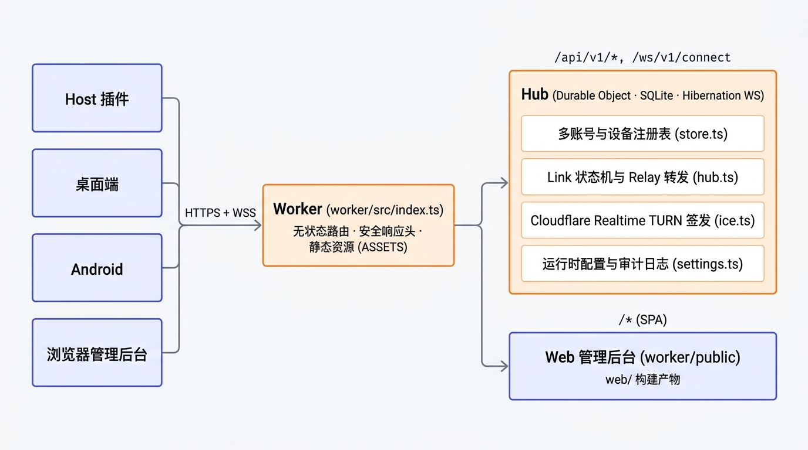
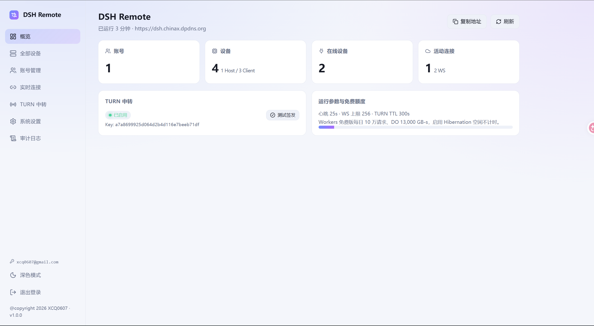
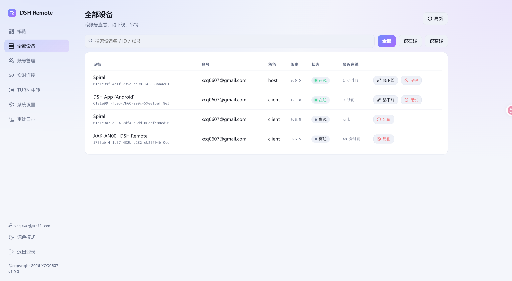
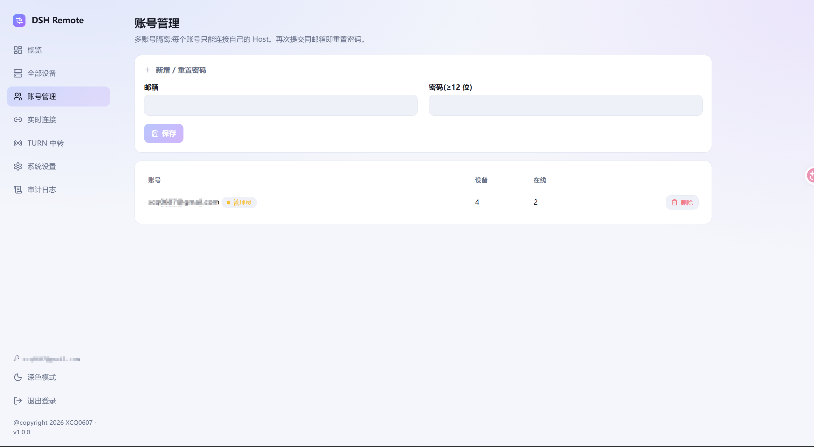
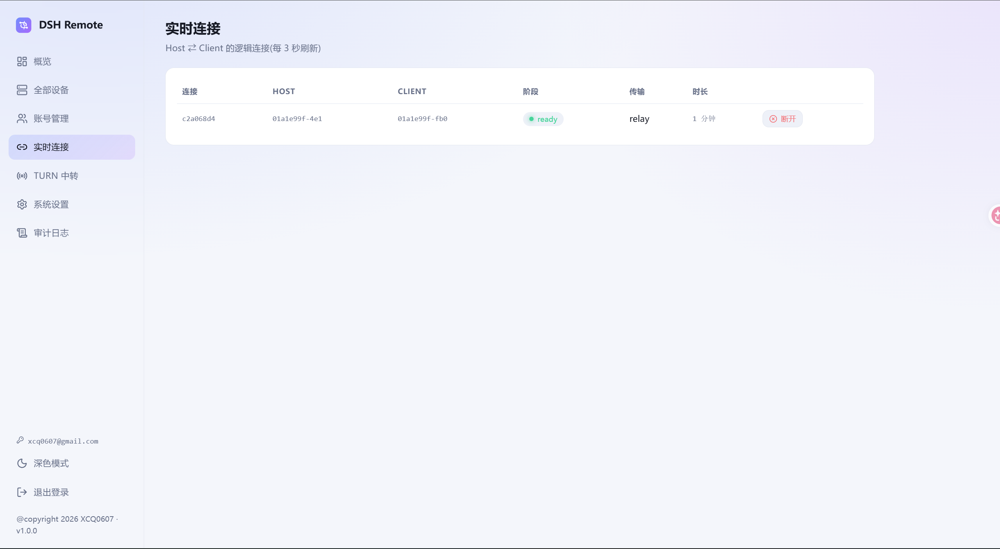
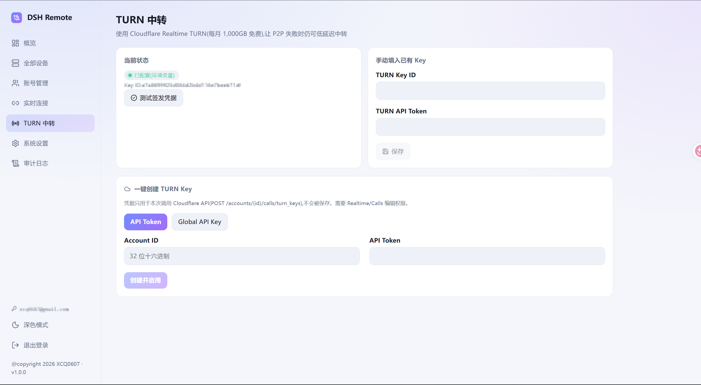
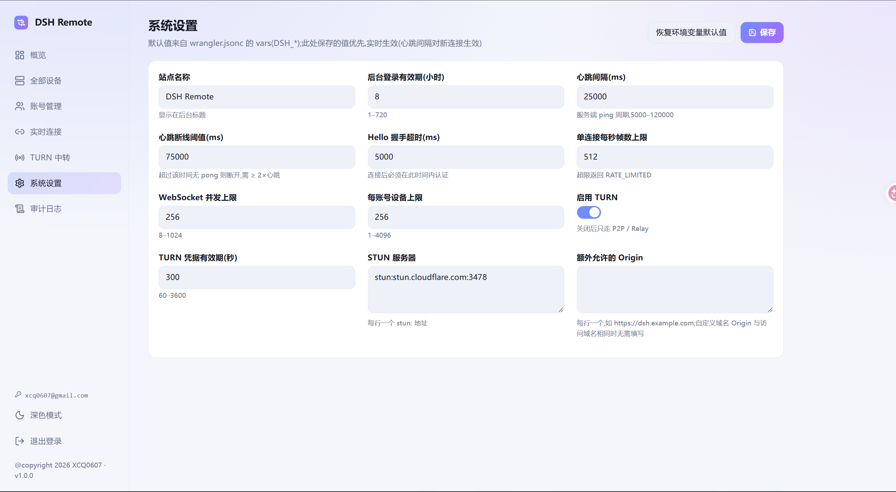
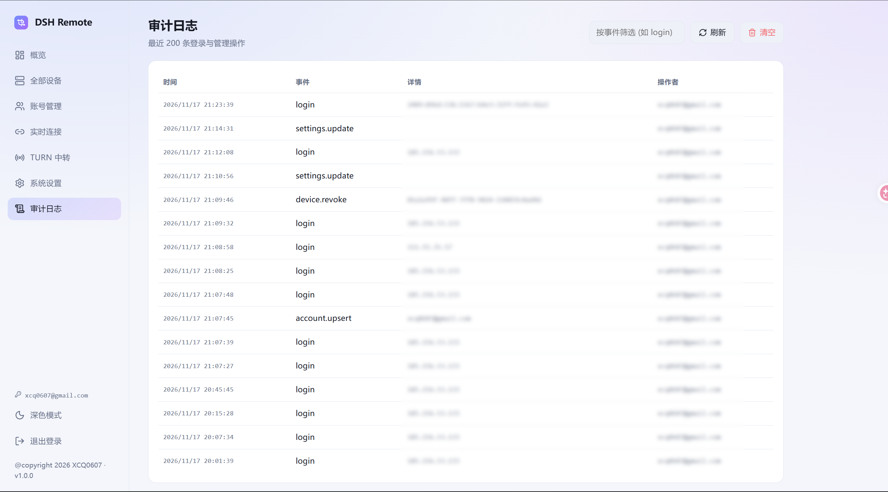

# DSH Remote Worker

[](https://github.com/XCQ0607/dsh-remote-worker/blob/main/package.json)
[](./LICENSE)
[](https://workers.cloudflare.com/)
[](https://www.typescriptlang.org/)
[](https://react.dev/)
[](https://github.com/XCQ0607/dsh-remote-worker)

基于 Cloudflare Workers + Durable Objects（SQLite + WebSocket Hibernation）重构的 `ds-harness-remote` 自建中转服务端，可在 Cloudflare **免费版**运行，支持**多账号隔离**、**Cloudflare Realtime TURN** 与现代化 **Web 管理后台**。

## 架构概览



```
Host 插件 / 桌面 / Android / 浏览器管理后台
        │ HTTPS + WSS
        ▼
Worker (worker/src/index.ts)          ← 无状态路由 + 安全响应头 + 静态资源 (ASSETS)
  ├─ /api/v1/* , /ws/v1/connect ───► Hub (Durable Object, SQLite 后端, Hibernation WS)
  │                                     ├─ 多账号存储与设备注册表 (store.ts)
  │                                     ├─ Link 状态机与 Relay 帧互转 (hub.ts)
  │                                     ├─ Cloudflare Realtime TURN 凭据签发 (ice.ts)
  │                                     └─ 运行时配置覆盖与审计日志 (settings.ts)
  └─ /* (SPA) ─────────────────────► web/ 构建产物 (worker/public)
```

> 说明：官方 Remote Web（浏览器内直接操作会话）未开源，本项目管理后台提供账号、设备、实时连接、TURN 与系统参数管理。

## 目录结构

- `worker/` — Cloudflare Worker + Durable Object 服务端源码与 `wrangler.jsonc`
- `web/` — React + TypeScript + Vite 管理后台前端，构建输出到 `worker/public`
- `scripts/deploy.mjs` — 一键部署脚本

---

## 方式一：一键脚本部署（推荐）

脚本 `scripts/deploy.mjs` 会自动完成：安装依赖、构建前端、解析账户 ID、部署 Worker、写入 `ADMIN_TOKEN` 与 TURN secrets、创建首个管理员账号，并生成 `deploy-output.json`（已 gitignore）。

支持直接通过根目录 `env.json` 传参（已加入 `.gitignore`，环境变量优先级高于 `env.json`）：

```bash
cp env-template.json env.json
# 编辑 env.json 填入对应字段后直接运行：
node scripts/deploy.mjs
```

### 1. 使用 API Token（推荐，支持自动创建 TURN Key）

Token 需包含 `Workers Scripts: Edit`、`Account Settings: Read`、`Calls / Realtime: Edit` 权限：

```bash
# PowerShell
$env:CLOUDFLARE_API_TOKEN="你的_API_Token"
$env:DSH_ACCOUNT="admin@example.com"
$env:DSH_PASSWORD="你的强密码(至少12位)"
node scripts/deploy.mjs
```

### 2. 使用 Global API Key（支持自动创建 TURN Key）

```bash
# PowerShell
$env:CLOUDFLARE_EMAIL="你的Cloudflare登录邮箱"
$env:CLOUDFLARE_API_KEY="你的Global_API_Key"
$env:DSH_ACCOUNT="admin@example.com"
$env:DSH_PASSWORD="你的强密码(至少12位)"
node scripts/deploy.mjs
```

### 3. 使用 `wrangler login` OAuth 登录后部署

```bash
npx wrangler login
# 若登录邮箱下有多个 Account，需指定：
# $env:CLOUDFLARE_ACCOUNT_ID="32位Account_ID"
$env:DSH_ACCOUNT="admin@example.com"
$env:DSH_PASSWORD="你的强密码(至少12位)"
node scripts/deploy.mjs
```

> 注意：`wrangler login` 的 OAuth Token 无权调用 Cloudflare Realtime TURN API，脚本会先以 Relay-only 部署。部署完成后，可登录管理后台 → **TURN 中转** → 填入 API Token 或 Global API Key 一键创建 TURN Key（或手动填入已有 Key）。

### `env.json` / 部署脚本全部变量说明

以下变量可写在根目录 `env.json` 中（也可通过系统环境变量覆盖，环境变量优先级更高）：

| 变量                      | 必填 | 默认值         | 说明                                                                                                          |
| ------------------------- | ---- | -------------- | ------------------------------------------------------------------------------------------------------------- |
| `CLOUDFLARE_API_TOKEN`  | 否   | `""`         | Scoped API Token（认证方式 1）                                                                                |
| `CLOUDFLARE_EMAIL`      | 否   | `""`         | Cloudflare 登录邮箱（认证方式 2，需配 `CLOUDFLARE_API_KEY`）                                                |
| `CLOUDFLARE_API_KEY`    | 否   | `""`         | Global API Key（认证方式 2）                                                                                  |
| `CLOUDFLARE_ACCOUNT_ID` | 否   | 自动检测       | 32 位 Account ID（多账户时必填；自动解析后会回填到 `env.json`）                                             |
| `WORKER_NAME`           | 否   | `dsh-remote` | 部署的 Worker 名称                                                                                            |
| `DSH_ACCOUNT`           | 否   | `""`         | 首个管理员账号邮箱（会自动加入 `ADMIN_ACCOUNTS` 并创建账号）                                                |
| `DSH_PASSWORD`          | 否   | `""`         | 首个管理员账号密码（**至少 12 位**）                                                                    |
| `ADMIN_TOKEN`           | 否   | 随机生成       | 管理员 API 密钥（**至少 16 位**；留空自动生成并回填到 `env.json`）                                    |
| `TURN_KEY_ID`           | 否   | `""`         | 已有 Cloudflare TURN Key ID（填入则直接绑定，不重复创建）                                                     |
| `TURN_KEY_API_TOKEN`    | 否   | `""`         | 已有 Cloudflare TURN API Token（自动创建成功后会与 ID 一起回填到 `env.json`）                               |
| `SKIP_TURN`             | 否   | `0`          | 设为 `1` 时跳过自动创建 TURN Key（仅 Relay）                                                                |
| `FORCE_TURN`            | 否   | `0`          | 设为 `1` 时即使已有 `TURN_KEY_ID` 也强制新建 TURN Key                                                     |
| `DSH_DO_LOCATION`       | 否   | `""`         | Durable Object 区域提示（`apac` / `wnam` / `enam` / `weur` / `eeur` / `oc` 等，仅对新建 DO 生效） |

---

## 方式二：手动配置与部署

适合希望自己逐步控制每个资源创建与绑定的用户。

### 1. 登录 Wrangler 并确认 Account ID

```bash
npx wrangler login
npx wrangler whoami
```

若账号下有多个 Account，记录目标 `Account ID`，后续命令前设置（PowerShell）：

```powershell
$env:CLOUDFLARE_ACCOUNT_ID="你的32位Account_ID"
```

### 2. 安装依赖并构建前端

```bash
cd worker && npm ci
cd ../web && npm ci && npm run build
```

### 3. 修改 `worker/wrangler.jsonc`

按需修改 `name`（Worker 名称，默认 `dsh-remote`）以及 `vars` 中的默认环境变量（后续可在管理后台「系统设置」中实时覆盖）：

| 变量                            | 默认值                            | 说明                                                                           |
| ------------------------------- | --------------------------------- | ------------------------------------------------------------------------------ |
| `DSH_SITE_NAME`               | `DSH Remote`                    | 站点与后台标题                                                                 |
| `ADMIN_ACCOUNTS`              | `xcq0607@gmail.com`             | **必改**：允许登录管理后台的管理员邮箱（逗号分隔）                       |
| `DSH_HEARTBEAT_MS`            | `25000`                         | WebSocket ping 心跳间隔（ms）                                                  |
| `DSH_HEARTBEAT_DISCONNECT_MS` | `75000`                         | 心跳超时断开阈值（ms）                                                         |
| `DSH_HELLO_TIMEOUT_MS`        | `5000`                          | 建连后 Hello 握手超时（ms）                                                    |
| `DSH_MAX_FRAMES_PER_SEC`      | `512`                           | 单连接每秒最大帧数                                                             |
| `DSH_MAX_CONNECTIONS`         | `256`                           | 最大并发 WebSocket 数                                                          |
| `DSH_MAX_DEVICES_PER_ACCOUNT` | `256`                           | 每账号最大设备数                                                               |
| `DSH_SESSION_HOURS`           | `8`                             | Web 登录有效期（小时）                                                         |
| `DSH_TURN_ENABLED`            | `true`                          | 是否启用 TURN                                                                  |
| `DSH_TURN_TTL_SECONDS`        | `300`                           | 短期 TURN 凭据有效期（秒）                                                     |
| `DSH_STUN_URLS`               | `stun:stun.cloudflare.com:3478` | 公共 STUN 地址（逗号分隔）                                                     |
| `DSH_ALLOWED_ORIGINS`         | `""`                            | 额外允许的 Origin（逗号分隔）                                                  |
| `DSH_DO_LOCATION`             | `""`                            | Durable Object 区域提示（`apac` / `wnam` / `weur` 等，仅对新建 DO 生效） |

### 4. 部署 Worker 与写入管理员密钥 (`ADMIN_TOKEN`)

```bash
cd worker
npx wrangler deploy --name dsh-remote
npx wrangler secret put ADMIN_TOKEN --name dsh-remote
```

> `ADMIN_TOKEN` 建议至少 16 位随机字符，用于调用 `/api/v1/admin/*` 接口创建首个账号。

### 5. 手动创建并绑定 TURN（可选，每月 1,000 GB 免费）

不配 TURN 也能使用（自动退化为 Relay-only），如需 TURN 有两种手动绑定方式：

- **方式 A（控制台创建 + Secret 绑定）**：
  1. 登录 Cloudflare 控制台 → 左侧 **Realtime → TURN 服务器** → 点击 **创建**。
  2. 记录生成的 **TURN Key ID** 和 **API Token / Secret**（仅创建时显示一次）。
  3. 写入 Worker Secret（或在控制台 Worker → **Settings → Variables and Secrets** 中添加）：
     ```bash
     cd worker
     npx wrangler secret put TURN_KEY_ID --name dsh-remote
     npx wrangler secret put TURN_KEY_API_TOKEN --name dsh-remote
     ```
- **方式 B（控制台创建 + 管理后台绑定）**：完成第 6、7 步登录管理后台后，进入 **TURN 中转 → 手动填入已有 Key** 保存即可。

### 6. 绑定自定义域名

国内网络直连 `*.workers.dev` 通常会超时，建议绑定托管在 Cloudflare 的自有域名：

1. 进入 Cloudflare 控制台 → **Workers & Pages** → 点击 `dsh-remote`。
2. 打开 **Settings → Domains & Routes → Add → Custom Domain**。
3. 输入子域名（如 `dsh.example.com`）并确认，Cloudflare 会自动添加 DNS 解析与 SSL 证书。

### 7. 手动创建首个管理员账号

确保该邮箱已写在 `ADMIN_ACCOUNTS` 中，然后调用接口创建账号（密码至少 12 位）：

```bash
curl -X POST https://你的域名/api/v1/admin/accounts \
  -H "Authorization: Bearer 你的ADMIN_TOKEN" \
  -H "Content-Type: application/json" \
  -d '{"email":"admin@example.com","password":"你的强密码(至少12位)"}'
```

创建完成后，直接浏览器访问 `https://你的域名` 登录，即可进入完整管理员后台。

---

## 管理后台与 TURN 使用

直接访问绑定的域名即可打开管理后台：

- **管理员账号**（在 `ADMIN_ACCOUNTS` 内）：可查看概览、跨账号设备管理（踢下线/吊销）、多账号增删改密、实时连接断开、**TURN 中转**（一键调用 Cloudflare API 创建 Key / 手动填入 / 测试签发）、**系统设置**（实时修改参数并支持恢复环境变量默认值）、审计日志。
- **普通账号**：登录后仅可查看自己账号下的设备状态。
- **TURN 配置**：Cloudflare Realtime TURN 每月提供 **1,000 GB** 免费流量。在后台「TURN 中转」页面支持三种配置方式：一键调用 Cloudflare API 创建、手动填入已有 Key ID + API Token，或通过 `wrangler secret` 注入。未配置 TURN 时自动退化为 Relay-only（经 Durable Object 转发密文）。

## 界面预览

| 概览 | 全部设备 |
| :---: | :---: |
|  |  |
| **账号管理** | **实时连接** |
|  |  |
| **TURN 中转** | **系统设置** |
|  |  |
| **审计日志** | |
|  | |

---

### 👥 贡献者 (Contributors)

<a href="https://github.com/XCQ0607/dsh-remote-worker/graphs/contributors">
  
</a>

## 📈 Star History

<a href="https://www.star-history.com/?repos=XCQ0607%2Fdsh-remote-worker&type=timeline&logscale=&releases=&legend=bottom-right">
 <picture>
   <source media="(prefers-color-scheme: dark)" srcset="https://api.star-history.com/chart?repos=XCQ0607/dsh-remote-worker&type=timeline&theme=dark&logscale&legend=bottom-right" />
   <source media="(prefers-color-scheme: light)" srcset="https://api.star-history.com/chart?repos=XCQ0607/dsh-remote-worker&type=timeline&logscale&legend=bottom-right" />
   
 </picture>
</a>

---

## 开源协议

本项目基于 [Apache-2.0 License](./LICENSE) 开源（Copyright © 2026 [XCQ0607](https://github.com/XCQ0607) · [GitHub 仓库](https://github.com/XCQ0607/dsh-remote-worker)）。协议栈参考上游 [liguobao/ds-harness-remote](https://github.com/liguobao/ds-harness-remote)（MIT）。
